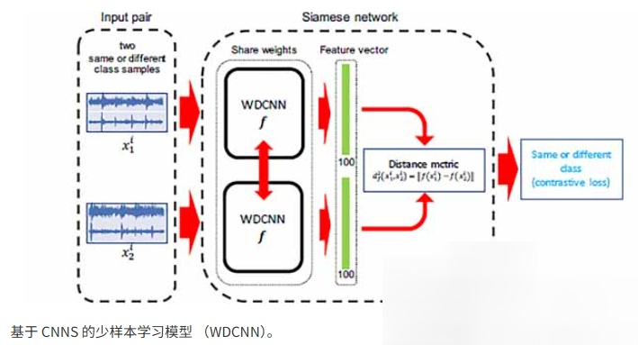
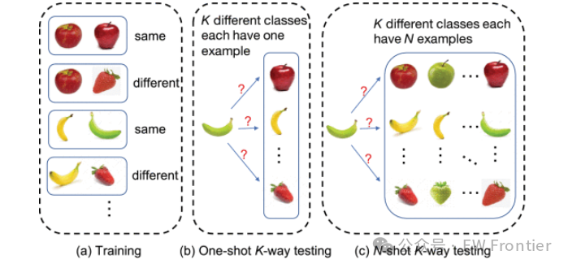
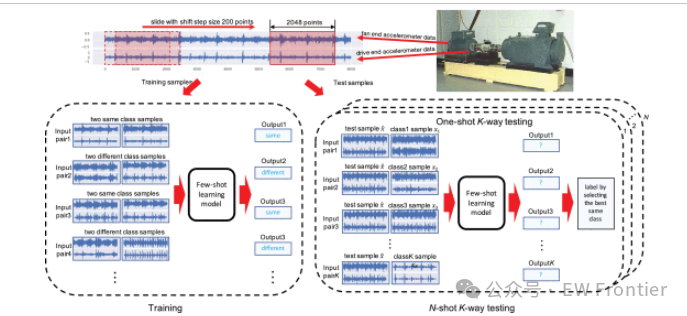
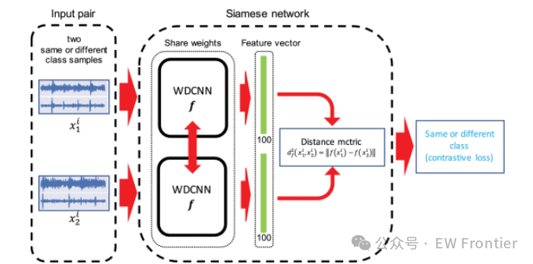
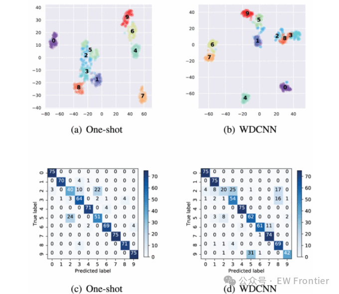

# [Fault Diagnosis] Limited Data Rolling Bearing Fault Diagnosis, Using Small Sample Learning [Attached Python Code]

This article focuses on the limited training data for bearing fault diagnosis. One major challenge in fault diagnosis is that it is not feasible to obtain sufficient training samples for each type of fault under all working conditions. In recent years, deep learning-based fault diagnosis methods have achieved promising results. However, most of these methods require a large amount of training data. In this study, we propose a few-shot learning method based on deep neural networks for rolling bearing fault diagnosis using limited data. Our model is based on a siamese neural network, which learns by exploiting either the same or different class samples. Experimental results on the Case Western Reserve University (CWRU) bearing fault diagnosis benchmark dataset show that our few-shot learning method is more effective in fault diagnosis when data availability is limited. When tested with the minimum training data in different noise environments, our few-shot learning model outperforms the baseline with reasonable noise level. When evaluated on test sets with new fault types or new working conditions, the small sample model performs better than the baseline trained with all fault types.
Some research on limited data fault diagnosis has been conducted. Hang et al. [9] proposed Principal Component Analysis (PCA) and applied it to the field of high-dimensional imbalanced fault diagnosis data. Duan et al. [10] utilized a new Support Vector Data Description method for mechanical fault diagnosis using imbalanced datasets. In recent years, deep learning has achieved impressive results in fields such as computer vision, image and video processing, speech recognition, and natural language processing [11]. Deep learning methods have also been applied to fault diagnosis, utilizing autoencoders (AE) [12]–[15], Restricted Boltzmann Machines (RBM) [16]–[19], Convolutional Neural Networks (CNN) [20]–[24], Recurrent Neural Networks (RNN) [25]–[27], and transfer learning-based neural networks [28]–[31] among other techniques achieving state-of-the-art results [6]. Additionally, Generative Adversarial Networks (GAN), such as Sun et al. [12] applying sparse autoencoders (SAE) neural networks, have achieved outstanding feature learning and classification performance in the field of induction motor fault diagnosis. Li et al. [16] applied two-layer Deep Boltzmann Machines (DBM) to learn deep representations of statistical parameters for gearbox fault diagnosis. Zhang et al. [22] proposed a Time-Integrated CNN (TICNN) for angular fault diagnosis, with its input being raw time series signals. Zhao et al. [27] designed a deep learning model called Convolutional Bidirectional Long Short-Term Memory Network (CBLSTM) by combining CNN and LSTM. To address different operational conditions in fault diagnosis, Shao et al. [14] proposed a fault diagnosis method based on transfer learning. Lu et al. [30] applied a novel deep neural network model with domain adaptation for fault diagnosis. Yang et al. [32] proposed a feature-based transfer neural network (FTNN). To solve the issue of imbalanced data in fault diagnosis, Cabrera et al. [33] used GAN models to evaluate the data distribution of each minority fault mode to increase its size comprehensively.
Deep neural networks' ability to learn low-level and high-level features from abundant datasets is well-known and has been widely used in fault diagnosis [5] and [6]. However, apart from transfer learning methods that can address time-varying conditions and data imbalance issues, most intelligent fault diagnosis methods based on deep neural networks have not solved one of the main challenges: there are limited fault samples for one or more fault types under all operating conditions.
Recently, deep neural networks based on few-shot learning have made significant progress in addressing the issue of data scarcity and have become an exciting field in machine learning. Few-shot learning was first addressed in the 1980s [38]. Fei-Fei et al. [34] developed a variational Bayesian framework for one-shot image classification, premised on the idea that when there are few examples available within a given category, previous learned classes can be leveraged to aid future predictions. Wolf et al. [35] focused on using metric learning methods that use standard feature vector representations to learn similarity kernels for insect image classification. Wu et al. [36] tackled one-shot learning problems in the context of robot-driven path planning algorithms. Koch et al. [37] proposed twin network architectures for one-shot image recognition. Vinyals et al. [39] applied matching networks to one-shot learning by adopting the concept of deep neural feature-based metric learning and leveraging external memory to enhance neural networks. Altae-Tran et al. [40] applied one-Shot learning to limited data drug discovery. Snell et al. [41] proposed a prototype network for few-shot learning by learning a metric space where classification can be performed by computing distances to construct prototypical representations for each class. Qiao et al. [42] proposed small-shot image recognition by predicting parameters from activations. Zhang et al. [43] introduced a conceptually simple and general framework called MetaGAN for few-shot learning problems. Unlike semi-supervised few-shot learning, their algorithm can handle both sample-level and task-level semi-supervision. However, despite the success of one-shot and few-shot learning in other applications, to our knowledge, these methods have not been applied to address the critical sample scarcity problem in rolling bearing fault diagnosis.
In this paper, we propose a Few-shot learning neural network method for rolling bearing fault diagnosis using limited data. Our contributions in this paper include:
We present a few-shot learning approach for bearing fault diagnosis based on limited data by developing twin neural network models with a wide first layer kernel of deep convolutional neural networks (WDCNN).
We demonstrate for the first time that a few-shot learning diagnosis model can improve fault diagnosis performance by fully utilizing either the same or different class samples to identify test samples from only one or a few samples. For example, on a small training set with 90 training samples, our method achieves an accuracy of 92.56% without using few-shot learning strategies, whereas without such strategies, the accuracy is 80.36%.
As the number of training samples increases, and when the test dataset significantly differs from the training dataset, the test performance does not monotonically increase.
Article illustrations
Conclusion
This paper presents a few-shot learning approach for rolling bearing fault diagnosis using limited data. Our algorithm addresses one of the main challenges in limited data fault diagnosis: obtaining sufficient sample quantities in data-driven fault diagnosis. Our few-shot fault diagnosis model is based on a siamese neural network for one-shot learning. Its working principle is to measure the "distance" between the output features vectors of two WDCNN twins, i.e., whether their outputs are considered very similar or different.
By comparing its performance with the baseline (a popular WDCNN fault diagnosis model), our method has been extensively validated on the CWRU dataset. The experimental results indicate that small-sample learning is effective for fault diagnosis both in data-limited or data-rich scenarios. By comparing test results under different noise environments, we found that significant differences between training and testing sets could lead to a non-monotonic increase in test performance as the number of training samples increases. When evaluating on test sets with new fault types or working conditions, small-sample models perform better than the baseline that uses all fault types trained.

## Images

<!-- PAYMENT_BLOCK -->

## Get this dataset

- Payment link (Stripe): [Buy now](https://buy.stripe.com/3cs8yP7sY87d0vu9AB)
- Payment QR code: 

<!-- /PAYMENT_BLOCK -->
